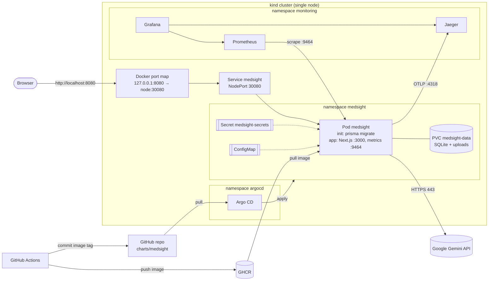

# Operations guide

How MedSight is built, delivered, run and repaired, and why each choice was made.

## 1. Architecture

| Component | Role | Depends on |
|---|---|---|
| Next.js app (one container) | UI, REST API, auth, report analysis | SQLite file, upload directory, Gemini |
| `migrate` init container | Applies Prisma migrations before the app starts | SQLite file |
| PVC `medsight-data` (local-path) | Keeps database and uploads across restarts and releases | Node disk |
| Gemini API | AI summary of uploaded reports | Internet egress, API key |
| Prometheus + Grafana | Metrics, SLO rules, dashboard | ServiceMonitor on `:9464` |
| Jaeger | Traces (in memory) | OTLP from the app |
| Argo CD | Syncs the Helm chart from git to the cluster | GitHub, GHCR |
| GitHub Actions | Tests, scans, builds and releases | GHCR, the `production` environment |

## 2. Request path

1. The browser calls `http://localhost:8080`. Docker publishes that port on the host loopback only and forwards
   it to port `30080` on the kind node container.
2. kube-proxy's iptables rules map NodePort `30080` to Service `medsight`, which only selects pods that are
   **Ready**. They forward the request to the pod IP on port `3000`.
3. Inside the pod, the OpenTelemetry HTTP instrumentation starts a span, Next.js routes the request, and the
   handler reads the session cookie and queries SQLite through Prisma at `/data/medsight.db` on the PVC.
4. For `POST /api/analyze-report`, the file is saved to `/data/reports` and sent to Gemini over HTTPS. This is the
   only egress the NetworkPolicy allows apart from DNS and Jaeger. The outbound call is a child span with its
   own latency and status metric.
5. When the response is sent, one JSON access-log line (with `trace_id`) goes to stdout, the histogram
   `http_server_request_duration` is updated, and the trace is exported to Jaeger.

## 3. Failure boundaries

| Failure | User impact | Detected by | What happens / recovery |
|---|---|---|---|
| Gemini down, quota hit or no key | Uploads fail with a clear error; login, history, feedback and sample mode keep working | `MedSightGeminiErrors`, dashboard "Gemini API calls" panel, 500s on `/api/analyze-report` | Readiness **does not** check Gemini, so the pod keeps serving. Fix the key/quota and recreate the Secret (`make secret`, then restart the pod) |
| Database unreadable | All signed-in features fail | `/api/ready` returns 503 → pod removed from Service; `MedSightDown` | Liveness does not check the DB, so there is no restart loop hiding the cause. Check the PVC and logs |
| App process hangs or crashes | Requests fail | Liveness probe (3 × 10 s) | kubelet restarts the container; the restart count is on the dashboard |
| Bad release (crash, failed migration, failing readiness) | **None**: the old pod keeps serving | Rollout never completes; `MedSightRolloutStuck` after 3 min | `maxUnavailable: 0` keeps the old ReplicaSet. Revert the commit (section 5) |
| Node or kind cluster lost | Full outage | `MedSightDown` | Single node by design (local environment). PVC data lives on that node only |
| Prometheus, Grafana or Jaeger down | None for users; we lose visibility | — | The app does not depend on them; trace export failures are dropped silently |
| Argo CD down | None for users; new releases wait | `kubectl -n argocd get pods` | The running version is unchanged; sync resumes when Argo CD is back |

## 4. From commit to running version

1. `git push` (any branch) starts `.github/workflows/ci-cd.yml`.
2. **verify**: `npm ci`, ESLint, `tsc`, Vitest, and `helm lint`/`helm template` on the chart.
3. **security-scan**: Trivy scans dependencies, committed secrets, and the Dockerfile and Helm chart. Fixable HIGH/CRITICAL findings fail the run.
4. **build**: Docker image built with `APP_VERSION=<commit SHA>`, scanned by Trivy (fails before pushing), then
   pushed as `ghcr.io/shivamgoeloss/medsight:<commit SHA>`. Tags are never reused, so a tag identifies exactly one build.
5. **deploy** (only `devops`/`main`): waits for **manual approval** on the `production` environment, then commits
   `image.tag: <SHA>` to `charts/medsight/values.yaml` as `release: medsight <sha7>`.
6. **Argo CD** polls git (about every 3 min), renders the chart and applies it. The Deployment rolls out: the new pod runs
   migrations, must pass startup and readiness probes, and only then is the old pod terminated.
7. Verify: `make status` (Argo sync revision, pods, `/api/version`), then `make smoke` (user journey).

**Where automation and approval sit:** everything up to a scanned image in the registry is automatic, because it is
cheap to undo and fully checked. Changing what users run needs a human approval, because releases affect real data
(migrations) and there is only one environment. After approval, the rollout itself is automatic and gated by probes.

**Traceability:** commit SHA = image tag = `APP_VERSION` = `/api/version` = `service_version` label in metrics
and traces = `version` in every log line = `app.kubernetes.io/version` label on the pod. Argo CD shows which
git revision is synced, and each release commit links to the pipeline run that produced it.

## 5. Release control and rollback

- **Strategy:** rolling update with `maxSurge: 1, maxUnavailable: 0` and readiness gating. It gives zero
  downtime and a bad version never receives traffic. Blue-green or canary would need two pods writing to one SQLite
  file, which the database does not support safely; with Postgres, a canary (Argo Rollouts) would be the next step.
- **Roll back (preferred, keeps git as the source of truth):** `git revert <bad commit> && git push`, approve the
  deploy. Or revert only the release commit (`git revert <release commit>`) to return to the previous image without
  rebuilding.
- **Emergency rollback:** Argo CD UI → History and Rollback (auto-sync must be paused first, otherwise
  self-heal returns to git).
- **Drift:** `selfHeal: true` reverts manual cluster edits (for example `kubectl scale` or `kubectl edit`) back to git;
  `prune: true` removes resources deleted from git. The PVC is excluded from pruning so patient data cannot be deleted by a sync.
- **Migrations:** forward-only (Prisma). A rollback that needs a schema downgrade means restoring the PVC
  from a backup. Schema changes should be backward compatible (expand, then contract).

## 6. Reliability targets and runbook

**Healthy means:** the pod is Ready, `/api/ready` returns 200, `make smoke` passes (sign up → session → patient API),
at least 99% of user requests are non-5xx, and p95 GET latency is under 500 ms. Probe traffic is excluded from all of these.

| SLO | SLI (Prometheus) | Target |
|---|---|---|
| Availability | `1 - medsight:request_error_ratio:rate1h` | 99% (30-day error budget 1%) |
| Latency | `medsight:get_latency_p95:rate5m` (GET only; uploads wait on Gemini for 30–60 s by design) | p95 < 500 ms |

**Verifying recovery** after any action: alert resolves in Prometheus, pod Ready with the expected
`/api/version`, the dashboard's error ratio returns below 1%, and `make smoke` passes.

### MedSightDown
No healthy scrape target for 2 min. Run `kubectl -n medsight get pods` and `kubectl -n medsight describe pod -l app.kubernetes.io/name=medsight`
→ look for CrashLoopBackOff, Pending (PVC/resources) or ImagePullBackOff → `kubectl -n medsight logs deploy/medsight --previous`.
If the last release caused it, roll back (section 5).

### MedSightErrorBudgetBurn
5xx ratio above 14.4% over both 1 h and 5 min, which spends 2% of the monthly budget per hour. Check the dashboard: if the errors are all
`POST /api/analyze-report` and the Gemini panel shows errors, follow MedSightGeminiErrors. Otherwise find failing paths with
`kubectl -n medsight logs deploy/medsight | grep '"status":5'`, open a `trace_id` in Jaeger, and roll back if this started with a release.

### MedSightLatencySLO
p95 GET above 500 ms for 10 min. Check pod CPU/memory against limits on the dashboard (CPU is unlimited and memory is limited to 768 Mi),
then slow spans in Jaeger. SQLite lock contention shows up as slow Prisma calls under load.

### MedSightRolloutStuck
A new version did not become Ready within 3 min. Users are still served by the old pod. Run `kubectl -n medsight get pods`,
then `kubectl -n medsight logs <new pod> -c migrate` (migration failed?) or `-c medsight`. Fix forward or revert the release commit.

### MedSightGeminiErrors
More than 50% of Gemini calls failing for 5 min. A 429 means quota (free tier resets daily); 403 means key or project blocked; no status
means network or DNS (check NetworkPolicy egress). Other features are unaffected. Update the key with `make secret` and
`kubectl -n medsight rollout restart deploy/medsight`.

## 7. Security controls

| Area | Control |
|---|---|
| Secrets | Gemini key only in the Kubernetes Secret created from the local, git-ignored `.env` (`make secret`); never in git, the image or CI logs. Grafana admin password generated at install time. CI uses the short-lived `GITHUB_TOKEN` only |
| Delivery permissions | Workflow default `contents: read`; `packages: write` only in build, `contents: write` only in deploy; actions pinned to commit SHAs; Trivy image pinned by digest; release requires reviewer approval |
| Supply chain checks | Trivy on dependencies, secrets, Dockerfile/Helm misconfiguration, and the built image. These checks forced the Next.js 14 → 15 and jspdf 2 → 4 upgrades and the OS patches in the image |
| Runtime | Non-root UID 1000, read-only root filesystem, all capabilities dropped, no privilege escalation, seccomp `RuntimeDefault`, no npm in the image |
| Kubernetes API | Dedicated ServiceAccount with no RBAC bindings and no token mounted |
| Network exposure | App reachable only on `127.0.0.1:8080`; metrics on a ClusterIP service; Grafana, Prometheus, Argo CD and Jaeger only via `kubectl port-forward`. NetworkPolicy default-deny: in on 3000 (and 9464 from `monitoring` only), out only DNS, Jaeger and public HTTPS (private and cluster ranges blocked) |
| Data | PVC protected from prune/uninstall. App-level controls (bcrypt, httpOnly cookies, authenticated file route, path-traversal check, tested in `tests/storage.test.ts`) were kept |

## 8. Linux, networking and cloud concepts in use

- **Processes and signals:** Node is PID 1 in the container; SIGTERM flushes telemetry before exit; Kubernetes waits up to 30 s.
- **Users and filesystems:** the app runs as an unprivileged UID; image files are root-owned and read-only; the only writable paths are
  volumes (`/data`, `/tmp`, `.next/cache`). `fsGroup: 1000` gives the pod group ownership of volumes that support it
  (local-path's hostPath directories are created world-writable instead, so it is not needed there).
- **Networking:** loopback-only port publishing, NAT from Docker to kind, kube-proxy iptables for NodePort and Service
  load balancing, cluster DNS (`jaeger.monitoring.svc`), NetworkPolicy as an L3/L4 firewall with CIDR exceptions for RFC 1918 ranges.
- **Cloud architecture:** pull-based GitOps (the cluster needs no inbound access from CI), an immutable image registry, a
  single-AZ and single-instance design with its failure domain stated explicitly (section 3).

## 9. Decisions and what would change them

| Decision | Why | Would change if |
|---|---|---|
| Deployment, 1 replica, no HPA | SQLite allows one writer and there is no shared identity to preserve | Moving to Postgres + object storage → 2+ replicas, HPA on CPU/RPS, PodDisruptionBudget, anti-affinity |
| Not a StatefulSet | One volume and no stable network identity needed; a StatefulSet's rolling update deletes the old pod first (downtime) | Several replicas each needing their own volume |
| RWO PVC with surge rollout | Works because kind has one node (both pods mount the same node path) | Multi-node: use `Recreate` (brief downtime) or move state out of the pod |
| NodePort on loopback instead of Ingress | One HTTP service, local only; an Ingress controller adds a component without a need | Several services, TLS or host routing → Gateway API / Ingress with cert-manager |
| Helm (one chart, one values file) | Templated config with no copied YAML; Argo CD renders it natively | Several environments → `values-<env>.yaml` overlays of the same chart |
| Argo CD (pull) over CI pushing with kubectl | GitHub cannot reach a laptop cluster; adds drift detection and history | A cloud cluster with OIDC → a CI push would also work, but GitOps would still be preferred |
| Manual approval before release | One environment holding real data, and migrations are forward-only | Staging plus a good automated test suite → automatic deploy to staging, approval for prod |
| Rolling update over canary/blue-green | Single-writer database; readiness gating already prevents bad versions serving | Postgres and real traffic → Argo Rollouts canary with metric analysis on the SLO |
| Logs via `kubectl logs` (JSON, with `trace_id`) | One service; logs are correlated to traces without another stack | More services or retention needs → Loki or a cloud log service |

## 10. Known limitations

- Single node, single replica: a node failure is a full outage, and the PVC is not backed up.
- The Secret is created by hand (`make secret`). In a shared environment, use Sealed Secrets, External Secrets or a cloud secret manager.
- No Alertmanager routing: alerts are visible in Prometheus and Grafana but nobody is paged.
- Jaeger and Prometheus keep data in memory or ephemeral storage and lose it if their pods restart.
- The GHCR package must be public, or the cluster needs an image pull secret.
- Argo CD tracks the `devops` branch until the PR is merged.
- The app's own limitations (no encryption at rest, no CSRF or rate limiting) are listed in the README and remain out of scope.
